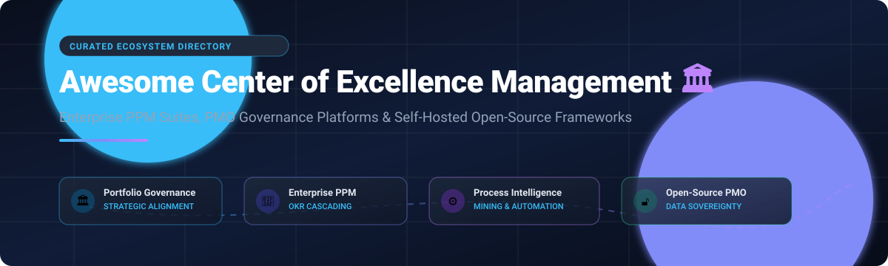

# Awesome-Center-Of-Excellence-Management

# Awesome-Center-Of-Excellence-Management 🏛️ 🎯

  

  
  
  
  
  
  

---

## 🌟 Top Center of Excellence Management Ecosystem

**Curated List of Commercial PPM Platforms & Open-Source Governance Frameworks**  
*Focused on Portfolio Management, Strategic Alignment, Resource Capacity Planning, OKR Cascading & Self-Hosted PMO Governance*

**Last updated: October 2026** 📅

---

### 📌 Overview & SEO Summary 🔍

Welcome to the definitive curated directory of **Center of Excellence (CoE) management platforms**, **enterprise Project Portfolio Management (PPM) suites**, **PMO governance orchestration frameworks**, and **open-source work tracking tools**. Whether evaluating multi-national SaaS platforms (*Broadcom Clarity*, *SAP LeanIX*, *Salesforce CoE*, *ServiceNow SPM*, *Celonis*, *Planview*) or deploying self-hosted, privacy-respecting open-source solutions (*AppFlowy*, *Plane*, *Odoo*, *Focalboard*, *OpenProject*, *Leantime*, *LibrePlan*), this guide provides clear comparative data on pricing, free tiers, team governance, OKR alignment, and enterprise IT portfolio agility.

**Key Market Insights & Architecture Highlights:** 💡
- 🏛️ **Continuous CoE Evolution:** Modern enterprise CoEs empower enterprise architects and PMO leaders to translate high-level corporate OKRs into agile sprints and operational milestones across cross-functional squads.
- ⚙️ **Process Intelligence & Conformance:** Leading enterprises pair automated process mining (*Celonis*, *PM4Py*) with PPM to uncover operational bottlenecks and streamline project intake workflows.
- 🔓 **Data Sovereignty & Self-Hosted Agility:** Open-source platforms (*OpenProject*, *Plane*, *AppFlowy*, *LibrePlan*) are surging as alternatives to bloated subscription models, providing on-premise compliance with GDPR and strict data sovereignty requirements.
- 🎯 **Strategy-to-Execution Cascading:** Modern tools (*Leantime*, *ServiceNow SPM*) connect strategic business pillars directly to work breakdown structures and effort-versus-impact scoring matrices.
- 🏢 **Collaborative Innersource Patterns:** Progressive organizations leverage inner-source governance patterns to turn central CoEs from bureaucratic bottlenecks into self-service enablers.

---

## 📑 Table of Contents 🧭
- [🏢 SaaS & Commercial Platforms](#-saas--commercial-platforms)
- [🔓 Open-Source GitHub Projects](#-open-source-github-projects)
- [🛠️ How to Contribute](#%EF%B8%8F-how-to-contribute-)
- [🤝 Support & Sponsorship](#-support--sponsorship-)
- [📊 Star History](#-star-history)
- [⚠️ Disclaimer](#%EF%B8%8F-disclaimer)

---

## 🏢 SaaS / Commercial Platforms

> **Market Overview:** The Project Portfolio Management (PPM) & Center of Excellence software market is valued at approximately **$6.2 Billion in 2026** (projected to reach ~$12.8 Billion by 2031 at ~15% CAGR). The sector is **moderately fragmented**, characterized by competition among enterprise megavendors (Broadcom, SAP, Salesforce, ServiceNow) alongside specialized best-of-breed PPM and process intelligence platforms (Planview, Celonis, monday.com, Asana) rather than a winner-take-all monopoly.

| SaaS / Commercial Platform | Company / Owner | Valuation / Market Cap | Standard Edition Starting Price | Free Tier / Free Trial Limits | Description |
| :--- | :--- | :--- | :--- | :--- | :--- |
| **[Clarity PPM](https://www.broadcom.com/)** 🏢 | Broadcom | ~$1.7 Trillion | **$23/user/month** ($69,000/yr benchmark for 250-seat tiers; minimum 20 user contracts) | **Free trial via guided POC** (evaluation instance arranged via enterprise sales; free Broadcom Academy coursework) | **Enterprise PPM by Broadcom** — **Portfolio investment planning, resource management, and financial governance** . |
| **[LeanIX](https://www.leanix.net/)** 🔷 | SAP | ~$245 Billion | **~$2,500/month** (~$30,000/year base tier tracking up to 200 applications with unlimited users) | **Free Academic Edition** (available for universities and researchers; commercial evaluation via 14-day guided proof-of-concept) | **Enterprise architecture management** — **Application portfolio management, technology risk, and roadmap planning** . **SAP integration** . |
| **[Salesforce Center of Excellence](https://www.salesforce.com/)** ☁️ | Salesforce | ~$190 Billion | **$25/user/month** (Starter Suite tier, billed annually or monthly) | **30-day free trial** (full access to Starter Suite, no credit card required) + **Free unlimited Trailhead CoE modules** | **CRM-native CoE governance** — **Salesforce CoE framework for governing Salesforce implementations** . **Trailhead modules for CoE establishment** . **Best for Salesforce-centric organizations** . |
| **[ServiceNow SPM](https://www.servicenow.com/)** 🟢 | ServiceNow | ~$145 Billion | **~$70/user/month** (approx. $10,000/year minimum platform contract threshold for fulfiller seats) | **Free Personal Developer Instance (PDI)** (full developer sandbox, valid up to 90 days, resets timer with logins every 10 days) | **Strategic Portfolio Management** — **Demand management, portfolio planning, and project execution** . **Deep integration with ServiceNow ITSM and ITBM** . |
| **[Adobe Workfront](https://www.workfront.com/)** 🎨 | Adobe | ~$94 Billion | **$30/user/month** (Select tier baseline for enterprise work management teams) | **30-day free trial / Test Drive** (guided sales sandbox environment with sample portfolio data) | **Enterprise work management** — **Project, portfolio, and resource management** . **Adobe Experience Cloud integration** . |
| **[Celonis](https://www.celonis.com/)** ⚙️ | Celonis | ~$12 Billion | **~$4,166/month** (~$50,000/year entry deployment for Process Intelligence Graph) | **Free Plan forever** (capped at 500 MB – 1 GB data upload limit, basic process mining) + **Free Celonis Academic Alliance** | **Process mining and execution management** — **Mines event logs to identify process inefficiencies** . **Process Intelligence Graph for automation opportunities** . |
| **[monday.com Enterprise](https://monday.com/)** 📈 | monday.com | ~$3.8 Billion | **$9/seat/month** (Basic tier, billed annually; $12/seat/month for Standard, 3-seat minimum) | **Free Plan forever** (up to 2 seats, 3 boards, max 200 items, 500 MB storage) + **14-day free trial of Pro tier** (no credit card required) | **Work OS platform** — **Portfolio dashboards, resource management, and automation** . **Enterprise-grade governance** . |
| **[Asana Enterprise](https://asana.com/)** 📊 | Asana | ~$2.2 Billion | **$10.99/user/month** (Starter tier billed annually; $24.99/user/month for Advanced Portfolio tier) | **Free Personal plan forever** (up to 2 users, unlimited tasks/projects, 100MB/file) + **30-day free trial of Advanced tier** | **Work management platform** — **Portfolio views, goals, and resource management** . **Enterprise-grade security and governance** . |
| **[Planview](https://www.planview.com/)** 🎯 | Planview | ~$1.6 Billion | **$20/user/month** ($240/user/year starting tier for Projectplace/Agileplace modules) | **30-day free trial** (fully functional trial for Projectplace & Agileplace, no credit card required) | **Enterprise PPM and strategic portfolio management** — **Portfolio prioritization, resource capacity planning, and financial governance** . **The most comprehensive enterprise PPM platform** . |

---

## 🔓 Open-Source GitHub Projects

*Sorted by GitHub_Stars_Count (Descending)* 🌟

- **[AppFlowy](https://github.com/AppFlowy-IO/AppFlowy)**   
  **Open-source, privacy-first workspace and knowledge governance**, AGPL-3.0 licensed. **Comprehensive alternative to Notion and Confluence** for building self-hosted Center of Excellence knowledge bases, SOP documentation hubs, process boards, and portfolio wikis with total data sovereignty. 📘 🏛️

- **[Plane](https://github.com/makeplane/plane)**   
  **Modern open-source software development and portfolio tracking platform**, AGPL-3.0 licensed. **Enterprise-grade alternative to Jira and Linear** featuring multi-project roadmaps, issue cycles, analytics, module breakdowns, and cross-team PMO synchronization. 🚀 🎯

- **[Odoo Community (Project module)](https://github.com/odoo/odoo)**   
  **Integrated PPM with ERP financial data**, LGPL-3.0 licensed. **Kanban boards, Gantt charts, timesheets, and multi-project dashboard** . **Financial integration with Odoo Accounting and HR** — planned vs actual hours, costs from timesheets, and invoices generated . **Real-time profitability per client** . **Free and open source; Enterprise from $31.10/user/month** . **Best for organizations needing PPM unified with ERP** . 🏢 💼

- **[Focalboard](https://github.com/mattermost-community/focalboard)**   
  **Self-hosted multilingual project management & team coordination board**, AGPL-3.0 licensed. **Directly embeds into Mattermost or runs standalone** to manage cross-functional CoE deliverable pipelines, project cards, table/calendar views, and milestone cadences. 📋 📌

- **[OpenProject](https://github.com/opf/openproject)**   
  **The leading open-source project and portfolio management software**, GPL-3.0 licensed. **Trusted by enterprises, public institutions, and highly regulated industries** . **Project and portfolio management, agile boards (Kanban, Scrum, SAFe), Gantt charts, product and release planning, time tracking, cost reporting, budgeting, bug tracking, wikis, forums, and meeting management** . **Integrations with Nextcloud, XWiki, GitHub, and GitLab** . **Community Edition free forever; Enterprise from €5.95/user/month** . **The most complete open-source PPM alternative to Jira and MS Project** . 🏛️ 📊

- **[Leantime](https://github.com/Leantime/leantime)**   
  **Strategy-first open-source PPM**, AGPL-3.0 licensed. **Starts with goals and links projects to strategic outcomes** . **Goal cascading, milestone tracking, and portfolio dashboard showing alignment against strategic pillars** . **Goal Matrix scores projects on effort vs impact** . **Built-in timeboxing and milestone dashboards prevent overcommitment** . **Community edition free for unlimited users; Pro from $4/user/month** . **The most strategy-aligned open-source PPM** . 🎯 💡

- **[Redmine](https://github.com/redmine/redmine)**   
  **Flexible project management web application**, GPL-2.0 licensed. **Unlimited customizability via plugins and Ruby on Rails** . **Ticket and Gantt views across projects** . **100% free and open source** . **The original battle-tested open-source project management tool** . 📋 🛠️

- **[Vikunja](https://github.com/go-vikunja/vikunja)**   
  **Self-hostable, end-to-end to-do and project organization platform**, AGPL-3.0 licensed. **Built with Go and Vue** featuring kanban boards, Gantt timelines, table overviews, subtasks, task relationships, and cross-team sharing for agile PMO execution squads. ⏱️ 📈

- **[Archi](https://github.com/archimatetool/archi)**   
  **Official ArchiMate implementation from The Open Group**, open-source. **The preferred tool for software architects and developers** . **Stores information in small-grain files on local file system** . **Git repository integration for collaboration** . **Lacking reporting and dashboarding** — all models on separate graphical canvas . **Jasper-based reporting for custom report generation** . **Best for individual application modeling and ArchiMate diagrams** . 🏗️ 📐

- **[PM4Py](https://github.com/process-intelligence-solutions/pm4py)**   
  **Python open-source process mining library**, GPL-3.0 licensed. **Comprehensive framework for process discovery, conformance checking, and operational bottleneck evaluation** — the essential open-source counterpart to Celonis for CoE process intelligence and audit verification. 🔬 ⚙️

- **[Taiga](https://github.com/kaleidos-ventures/taiga)**   
  **Agile project management for multi-team portfolios**, AGPL-3.0 licensed. **Scrum and Kanban support across projects** . **Cross-project Epic Board and Swimlane views** . **Self-hosted or Taiga Cloud from $19/month** . **The most agile-focused open-source PPM** . 🎯 🏃

- **[LibrePlan](https://github.com/LibrePlan/libreplan)**   
  **Self-hosted project governance for public sector and digital sovereignty**, AGPL-3.0 licensed. **Used internationally since 2009** . **Project and portfolio planning, resource allocation and capacity management, issue and risk tracking, governance and transparency, milestone and deadline monitoring, multi-user collaboration, and auditability** . **Version 1.6.0 adds issue and risk log management, project document repositories, project pipeline overview, project status indicators, and expanded notifications** . **The most governance-focused open-source PPM** . 🏛️ 🇪🇺

- **[Orangescrum Community Edition](https://github.com/Orangescrum/opensource-community-edition)**   
  **Service-oriented PPM for client project portfolios**, AGPL-3.0 licensed. **Invoicing and resource availability dashboards** . **Self-hosted Community Edition free; Cloud from $9/month** . **Best for service teams managing client portfolios** . 📊 💼

- **[MyGGI Board (OSPO Alliance)](https://github.com/ospo-alliance/my-ggi-board)**   
  **Push-button Open Source Program Office governance infrastructure**, open-source. **Deploys the Good Governance Initiative Handbook in minutes** . **25 activities modeled with scorecards for maturity assessment** . **Agile-like sprints for progressing through open source best practices** . **The definitive open-source CoE framework for open source program offices** . 🏢 🌐

---

## 🛠️ How to Contribute 🤝

Contributions are welcome! Follow these steps to submit new CoE management platforms or open-source governance software:

1. 🍴 **Fork** the repository.
2. 📝 **Add/edit** entries in `README.md` maintaining table/list structure and formatting.
3. 🔗 Include project title, official website/GitHub link, exact Stars_Count, license, and brief description.
4. 🚀 Submit a **Pull Request** with a descriptive summary of your changes.

---

## 🤝 Support & Sponsorship 💖

Thank you so much for exploring and using this Center of Excellence management repository! If you find this curated collection helpful for your PMO, portfolio management, or governance initiatives, please consider supporting the project:

- ⭐ **Star this repository** to increase visibility and help others discover it!
- 🔀 **Fork & Share** with fellow engineering directors, PMO leaders, portfolio managers, and open-source advocates.
- ☕ **Buy Me a Coffee / Sponsor**: Support ongoing maintenance and open-source curation via the [GitHub Sponsor Dashboard (https://github.com/sponsors/ishandutta2007)](https://github.com/sponsors/ishandutta2007).

---

##  Star History

---

## ⚠️ Disclaimer

- This is a **community-curated** list — not exhaustive and not an endorsement. ℹ️
- **CoE models can become bottlenecks** — **application teams become customers of the CoE, submitting requests that get prioritized into a shared backlog**, and when priorities differ, organizational politics ensue [citation:18]. **Innersource patterns** — defaulting to internal repository visibility, using CODEOWNERS, and accepting contributions from anywhere — offer an alternative that scales without centralization [citation:18].
- **Open-source PPM is gaining traction due to subscription inflation** — **three movements are driving adoption: data-sovereignty-first buying (GDPR, defense contracts), OKR integration directly into the work breakdown, and API-driven portfolio dashboards that stitch together best-of-breed open tools** [citation:3].
- **Essential Open Source EA Tool requires intensive training** — the data entry in the Open Source version requires **understanding of the underlying meta model**, and extending the metamodel can **endanger upgrade compatibility** [citation:13].
- **Open-source CoE tools are not turnkey** — **OpenProject requires PostgreSQL and Ruby** . **LibrePlan requires Java and PostgreSQL** . **Essential EA requires Protege and older Java versions** . **Always validate portfolio alignment, resource capacity planning, and governance workflows with a proof-of-concept** before production deployment. 🏛️

---

  <b>Made with ❤️ for PMO leaders, portfolio managers, and open-source governance advocates.</b>

